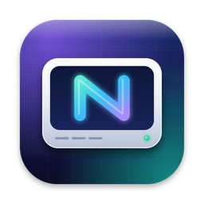

<p align="center">
  
</p>

<h1 align="center">MacNTFS</h1>
<p align="center"><b>Lee y escribe discos NTFS de Windows en tu Mac. Libre, gratuito y de código abierto.</b></p>

---

Conecta un disco formateado en Windows y úsalo en Finder como cualquier otro: copiar, borrar, renombrar. Sin prueba de 10 días, sin números de serie y sin bajar la seguridad del Mac.

## Funciones

| | |
|---|---|
| **Lectura y escritura NTFS** | Motor ntfs-3g, archivos de más de 4 GB, nombres en cualquier alfabeto y atributos extendidos de macOS. |
| **Montaje automático** | Al conectar el disco, MacNTFS lo toma del driver de solo lectura de Apple y lo vuelve a montar con escritura. |
| **Protección de datos** | Detecta discos mal expulsados (los repara antes de montarlos), Windows hibernado o con Inicio rápido (ofrece montarlo en solo lectura) y volúmenes BitLocker. |
| **Verificar y reparar** | `ntfsfix` desde la app o desde Terminal. |
| **Borrar / formatear** | NTFS, exFAT, FAT32, Mac OS Plus y APFS, por volumen o por disco completo (MBR/GPT). |
| **Opciones por volumen** | Solo lectura, no montar automáticamente, ignorar propietarios, guardar último acceso e indexar con Spotlight. |
| **Barra de menús** | Estado de los discos, montar, desmontar y expulsar con un clic. |
| **Preferencias** | Activar o desactivar el driver, políticas de seguridad, actualizaciones, alertas, tema y desinstalador. |
| **Terminal** | `macntfs list · mount · unmount · verify · repair · format` |

## Por qué no necesita modo Recuperación

Los drivers comerciales cargan una **extensión de núcleo**. En Mac con Apple Silicon eso obliga a reiniciar en modo Recuperación y elegir *Seguridad reducida*. MacNTFS usa **FUSE-T**, que funciona en espacio de usuario: solo se instala una app y se escribe la contraseña una vez.

```
Finder ──► FUSE-T (espacio de usuario) ──► ntfs-3g ──► /dev/diskNsM
              ▲
MacNTFS.app ──┴── macntfs-helper (root, valida cada argumento)
```

## Compilar los DMG (ARM e Intel)

Requisitos en tu Mac:

1. **Xcode** o las Command Line Tools: `xcode-select --install`
2. **Homebrew**: <https://brew.sh>
3. **FUSE-T** (aporta las cabeceras para compilar ntfs-3g):
   `brew install macos-fuse-t/homebrew-cask/fuse-t`
4. Opcional, para un DMG con fondo e ícono: `brew install create-dmg`

Después:

```bash
cd MacNTFS
./build.sh            # genera dist/MacNTFS-1.0.0-AppleSilicon.dmg y dist/MacNTFS-1.0.0-Intel.dmg
./build.sh arm64      # solo Apple Silicon
./build.sh x86_64     # solo Intel
```

El script instala automáticamente autoconf, automake, libtool y pkg-config si faltan, descarga ntfs-3g de su repositorio oficial, lo compila para cada arquitectura (también en compilación cruzada) y empaqueta la app firmada localmente (firma ad-hoc).

Variables opcionales:

| Variable | Para qué |
|---|---|
| `MACNTFS_VERSION` | Versión del paquete (por defecto `1.0.0`). |
| `MACNTFS_REPO` | `usuario/repositorio` de GitHub donde publicarás las versiones; lo usa el buscador de actualizaciones y el botón "Reportar un problema". |
| `MACNTFS_SIGN_ID` | `Developer ID Application: …` si tienes cuenta de desarrollador de Apple (sin avisos de Gatekeeper). |

> Si `swift build` falla al compilar para Intel en un Mac con Apple Silicon, instala Xcode completo (no solo las Command Line Tools) o compila esa arquitectura en un Mac Intel.

## Instalar

1. Abre el DMG de tu arquitectura y arrastra **MacNTFS** a **Aplicaciones**.
2. Ábrela. Si la descargaste de internet y macOS no puede verificarla: *Ajustes del Sistema → Privacidad y seguridad → Abrir igualmente*.
3. Sigue la ventana de bienvenida: FUSE-T → **Instalar componentes**.

Los componentes se instalan en `/usr/local/libexec/macntfs`, `/usr/local/bin/macntfs` y `/etc/sudoers.d/macntfs`. Esta última regla permite montar, desmontar, verificar y reparar sin pedir la contraseña cada vez. **Formatear siempre la pide.**

Para desinstalar: *Preferencias → General → Desinstalar…* y luego mueve la app a la Papelera.

## Estructura del proyecto

```
Sources/MacNTFS/
  App/        punto de entrada, menús y panel "Acerca de"
  Model/      volúmenes, opciones por volumen, preferencias y errores de montaje
  Core/       DiskArbitration, tabla de montajes, operaciones privilegiadas,
              VolumeManager (montaje automático y políticas), registro, notificaciones y actualizaciones
  UI/         ventana principal, detalle, verificación, borrado, bienvenida, preferencias y barra de menús
Resources/helper/   macntfs-helper (root), install.sh, uninstall.sh y la herramienta macntfs
scripts/            build-ntfs3g.sh, build-app.sh y make-dmg.sh
branding/           logo (SVG/PNG/ICNS) y fondo del DMG
replica/            análisis funcional (recon) y matriz de funciones
```

## Limitaciones conocidas

- La reparación (`ntfsfix`) corrige errores básicos y limpia el registro. No sustituye a `chkdsk /f` de Windows.
- Los volúmenes BitLocker, RAID o dinámicos no se pueden montar.
- La indexación de Spotlight puede no estar disponible con FUSE-T.
- El rendimiento con FUSE-T es bueno para uso diario, pero menor que el de un driver de núcleo.

## Licencia

GPL-2.0-or-later. MacNTFS incluye ntfs-3g (© Tuxera Inc. y colaboradores, GPL). FUSE-T y macFUSE son proyectos independientes con sus propias licencias y no se incluyen en el DMG.

Desarrollado por **Santiago Miguel** · chago2850@gmail.com
